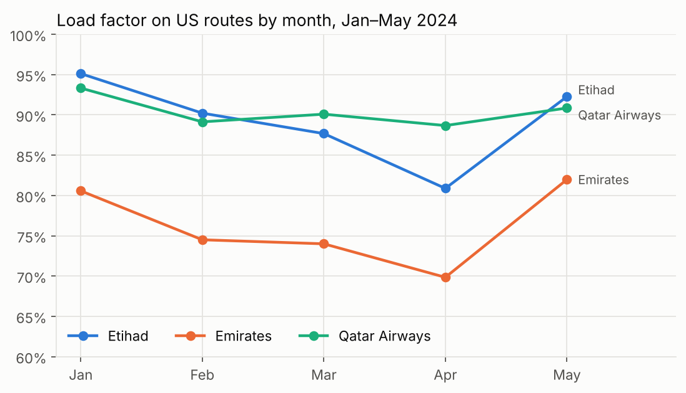
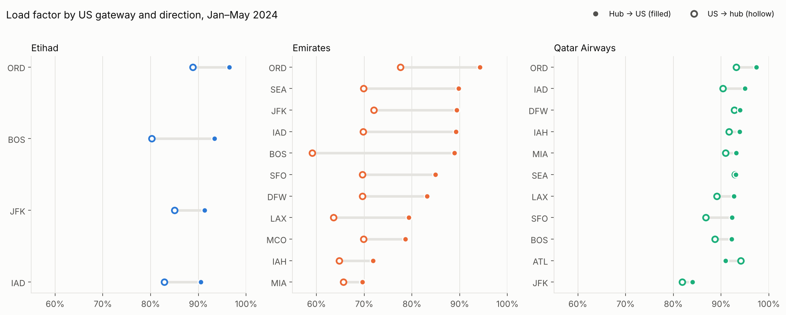
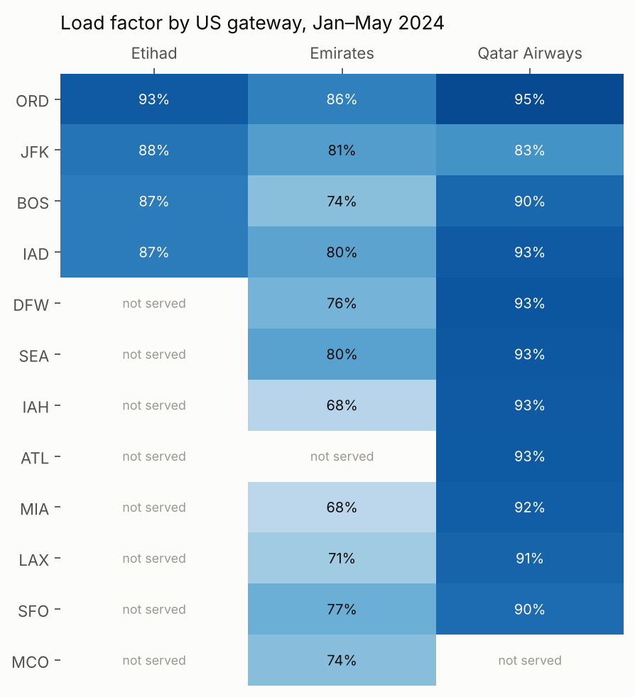

# Gulf Carriers on US Routes: Load Factor, Capacity & Network Analysis

How does **Etihad's** US network perform against its Gulf peers, **Emirates** and **Qatar Airways**? And what do load factor and capacity signals say about where demand is strongest?

This project uses official U.S. Department of Transportation **T-100 Segment** data (January–May 2024) to compare the three carriers on core airline KPIs:

- **load factor**
- **ASK** (available seat kilometres)
- **RPK** (revenue passenger kilometres)
- **aircraft gauge**
- **directional demand**



## Key findings

| KPI (Jan–May 2024, US routes) | Etihad | Emirates | Qatar Airways |
|---|---|---|---|
| US gateways | 4 | 11 | 11 |
| Load factor | **89.1%** | 76.3% | 90.4% |
| Seats | 398k | 1.48m | 1.55m |
| ASK (millions) | 4,497 | 17,979 | 18,430 |
| Seats per departure | 309 | 423 | 344 |

1. **Etihad's US routes are full; its network is narrow.** Nearly 9 in 10 seats are filled, yet Etihad holds only about 12% of Gulf-carrier US seats and serves 4 gateways against 11 for each peer.
2. **Chicago is the strongest capacity signal.** It has Etihad's highest load factor in both directions (96.5% from Abu Dhabi), on its largest aircraft (A350-1000/A380).
3. **Boston ramped up fast.** It launched in late March 2024, rising from 78% load factor in April to 96% in May.
4. **Emirates has a strong westbound skew.** Dubai → US flights run about 15 points fuller than the return, and up to 30 points on Boston. Etihad's weaker direction still stays above 80%, while Qatar Airways is almost perfectly balanced.
5. **The March–April dip is sharpest for Etihad.** Load factor falls from 95% to 81%, against 5 points for Qatar Airways. That's the window where pricing, fare-brand upsell and direct-channel campaigns do the most to protect revenue.





## KPI definitions

| KPI | Definition |
|---|---|
| Load factor | Passengers ÷ seats |
| ASK | Seats × distance (km). Capacity offered. |
| RPK | Passengers × distance (km). Traffic carried. |
| Gauge | Average seats per departure |
| PRASK | Passenger revenue per ASK = yield × load factor. *Not computable here: T-100 has no revenue data.* |

## Method

1. Filter to scheduled passenger service (`CLASS = F`) with seats reported.
2. Tag each segment as hub → US or US → hub, and exclude Emirates' fifth-freedom routes (New York–Athens, New York–Milan).
3. Restrict to **January–May 2024**, the months all three carriers have reported in this extract. Coverage differs by carrier, so a longer window would bias comparisons.
4. Aggregate to carrier, gateway, direction and month, then compute load factor, ASK, RPK, gauge and weekly frequency.

## Limitations

- No fare or revenue data, so yield and PRASK can't be calculated.
- Covers flights touching the US only. It isn't a view of each airline's full network.
- Load factor shows demand, not profitability. Route decisions also depend on cost (CASK), aircraft availability and traffic rights.
- Aircraft types are as reported to BTS.

## Repository structure

```
├── data/
│   ├── raw/t100_segment_gulf_carriers_2024.csv   # T-100 rows for EY, EK, QR (2024)
│   └── lookups/                                   # BTS aircraft-type and service-class lookups
├── notebooks/gulf_carriers_us_routes.ipynb        # full analysis with outputs
├── images/                                        # charts used in this README
└── requirements.txt
```

## Run it

```bash
pip install -r requirements.txt
jupyter notebook notebooks/gulf_carriers_us_routes.ipynb
```

## Data source

U.S. Department of Transportation, Bureau of Transportation Statistics: T-100 Segment (All Carriers), via [TranStats](https://www.transtats.bts.gov/). This is U.S. government data in the public domain. The 2024 extract was obtained via the [admacpherson/t-100-aviation-data](https://github.com/admacpherson/t-100-aviation-data) repository and filtered to the three Gulf carriers.

---
*Abhijeet Santhosh Kumar · [LinkedIn](https://www.linkedin.com/in/abhijeet-santhosh/)*
